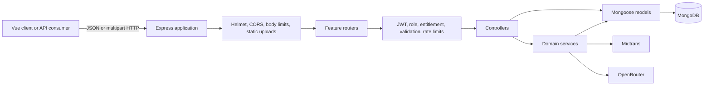
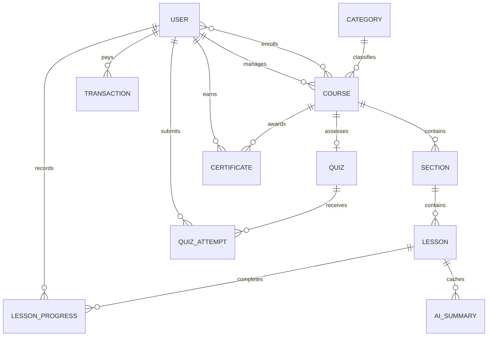

<div align="center">

# Cohortly — Backend API

**A production-oriented REST API for managing paid instructor workspaces, structured courses, student learning, assessments, and verifiable completion records.**


[API reference](docs/API.md) · [Architecture](docs/ARCHITECTURE.md) · [Database](docs/DATABASE.md) · [Development guide](docs/DEVELOPMENT.md) · [Demo scenarios](docs/demo-scenarios.md)

<p align="center">
  <a href="#overview">Overview</a>
  ·
  <a href="#key-features">Features</a>
  ·
  <a href="#tech-stack">Stack</a>
  ·
  <a href="#system-architecture">Architecture</a>
  ·
  <a href="#api-overview">API</a>
  ·
  <a href="#getting-started">Start</a>
  ·
  <a href="#project-structure">Structure</a>
  ·
  <a href="#engineering-highlights">Highlights</a>
</p>

</div>

##  Overview

Cohortly is the backend for a business-to-business learning management system. It gives instructors a subscription-gated workspace for managing students, authoring ordered text and video courses, publishing learning content, tracking progress, building final quizzes, and issuing certificates. Students consume published courses through a separate learning API with enrollment, entitlement, and ownership checks applied at the server boundary.

The service also integrates with Midtrans for manual activation and renewal payments and can optionally provide lesson-grounded study assistance through OpenRouter. Core learning, assessment, payment, and certificate rules remain deterministic and do not depend on AI availability.

##  Key features

- **Identity and workspace access** — instructor registration, JWT sessions, password changes, instructor/student roles, ownership isolation, and access derived from successful subscription payments.
- **Course and learner management** — instructor-scoped students, enrollments, categories, draft/published courses, ordered sections and lessons, sanitized rich text, and hardened image uploads.
- **Learning and progress** — published-course access, lesson navigation, idempotent completion updates, derived progress, next-activity selection, and instructor reporting.
- **Assessment and certification** — one final quiz per course, server-side scoring, private attempt history, answer-key separation, idempotent certificate issuance, and public certificate verification.
- **Payments and renewals** — Midtrans hosted checkout, signed webhook verification, amount validation, replay-safe state transitions, and calendar-month entitlement periods.
- **Optional AI assistance** — lesson questions, cached summaries, practice questions, and instructor-reviewed quiz drafts, with provider isolation, context limits, output validation, and usage controls.

##  Tech stack

| Area | Technology |
| --- | --- |
| Runtime | Node.js 22+, ECMAScript modules |
| HTTP | Express 4, CORS, Helmet |
| Database | MongoDB, Mongoose 8 |
| Authentication | JSON Web Tokens (HS256), bcrypt |
| Validation | Zod, Mongoose validation |
| Uploads and content | Multer, `file-type`, `sanitize-html` |
| Testing | Node.js test runner, Supertest, MongoDB Memory Server |
| External services | Midtrans; OpenRouter when AI is enabled |

##  System architecture

The codebase follows a route–middleware–controller structure, with domain services for workflows shared across controllers. Mongoose models own persistence rules and indexes; focused utility modules hold pure logic such as progress calculation, quiz scoring, subscription periods, sanitization, and ownership lookups.



A typical protected request is authenticated, checked for the required role and active workspace entitlement, validated, and then passed to a controller. Controllers enforce resource ownership and delegate multi-step rules—such as payment checkout, course publishing, cascade deletion, progress aggregation, or certificate issuance—to services. Errors are normalized centrally as JSON and do not expose stack traces.

See [docs/ARCHITECTURE.md](docs/ARCHITECTURE.md) for workflow and consistency details.

##  API overview

All routes use the `/api` prefix. Protected calls send `Authorization: JWT <token>`.

| Method | Endpoint | Description | Access |
| --- | --- | --- | --- |
| `GET` | `/api/health` | Service health check | Public |
| `POST` | `/api/sign-up` | Create an instructor and start activation checkout | Public, rate limited |
| `POST` | `/api/sign-in` | Authenticate and return workspace entitlement | Public, rate limited |
| `GET` | `/api/me` | Return current identity and entitlement | Authenticated |
| `GET` | `/api/courses` | List the instructor's courses | Instructor, active workspace |
| `POST` | `/api/courses/:courseId/sections` | Add an ordered course section | Instructor, owner |
| `GET` | `/api/students-courses/:courseId` | Read an enrolled, published course | Student, active workspace |
| `PUT` | `/api/lessons/:lessonId/completion` | Idempotently complete a lesson | Student, enrolled |
| `POST` | `/api/students-courses/:courseId/quiz/attempts` | Submit and score a final quiz | Student, enrolled |
| `GET` | `/api/certificates/verify/:certificateNumber` | Verify safe certificate fields | Public, rate limited |
| `POST` | `/api/handle-payment-midtrans` | Process a signed payment notification | Midtrans signature |
| `POST` | `/api/courses/:courseId/quiz/ai-draft` | Generate an unsaved quiz draft | Instructor, owner, AI enabled |

The complete route inventory, request shapes, access rules, and error contract are documented in [docs/API.md](docs/API.md).

##  Authentication and security

- Tokens are HS256 JWTs with `iat`, `exp`, and a one-day lifetime. The user and role are reloaded on every protected request.
- Passwords are hashed with bcrypt using 12 rounds. New passwords must contain 8–72 characters.
- Changing a password updates a credential timestamp, invalidating every previously issued token for that account.
- Instructor and student roles are enforced separately from subscription entitlement. Foreign resources resolve as `404` to reduce identifier probing.
- Zod validates JSON bodies and route identifiers; rich-text lessons are sanitized before storage and again when legacy content is read.
- Course and avatar uploads accept one JPEG or PNG up to 2 MB. Declared MIME type and file signature are both checked, and generated filenames ignore the client filename.
- Helmet headers, an explicit CORS allow-list, a 1 MB JSON limit, centralized safe errors, and targeted in-memory rate limits provide the HTTP security baseline.
- Midtrans notifications require a valid SHA-512 signature and an amount matching the stored order before an atomic pending-state transition is attempted.

These controls are implementation safeguards, not a claim of formal security certification. Operational limitations are listed below.

##  Database design

MongoDB is accessed through Mongoose. The primary hierarchy is `Course → Section → Lesson`; enrollments connect students to courses, while progress stores one completion record per student and lesson. Quizzes embed their questions and options because they are read and updated as one aggregate. Attempts and certificates are immutable historical records rather than mutable counters.

Important database guarantees include unique user emails, one quiz per course, one lesson completion per student/lesson, one certificate per student/course, and unique public certificate numbers. Progress percentages and workspace access are calculated from source records rather than stored as duplicated state.



Schema, indexes, cascade policies, and migration utilities are covered in [docs/DATABASE.md](docs/DATABASE.md).

##  Getting started

### Prerequisites

- Node.js 22 or newer (`file-type` requires Node 22)
- npm
- A reachable MongoDB database
- Midtrans credentials only when testing registration or checkout
- An OpenRouter API key only when enabling the optional AI routes

### Installation

```bash
git clone https://github.com/Indo86/cohortly-backend.git
cd cohortly-backend
npm ci
cp env.example .env
```

Set the four required values in `.env`:

```dotenv
DATABASE_URL=mongodb://127.0.0.1:27017/lms
SECRET_KEY_JWT=replace-with-a-long-random-secret
APP_URL=http://localhost:3000
FRONTEND_URL=http://localhost:5173
```

Keep `AI_ENABLED=false` unless OpenRouter is configured. The application can start without Midtrans settings, but registration and checkout fail closed until `MIDTRANS_URL` and `MIDTRANS_AUTH_STRING` are provided.

Initialize reference data and start the development server:

```bash
npm run seed
npm run dev
```

The API listens on `http://localhost:3000` by default. Verify it with:

```bash
curl http://localhost:3000/api/health
```

For a resettable portfolio workspace instead of categories alone, use `npm run seed:demo`; the script refuses production-looking targets. Run the service without file watching with `npm start`. There is no compilation step.

See [docs/DEVELOPMENT.md](docs/DEVELOPMENT.md) for every environment variable, script, migration, and troubleshooting note.

##  Testing and quality

```bash
npm test
```

The suite runs serially with Node's built-in test runner. Supertest exercises the HTTP boundary, MongoDB Memory Server isolates persistence, provider calls are mocked, and pure domain tests cover subscription arithmetic, publishing, progress, quiz scoring, certificates, authorization, uploads, errors, and AI context handling.

The repository currently has no lint, formatting, static type-check, or CI/CD command configured; `npm test` is the available automated quality gate.

##  Engineering highlights

1. **Payment history is the entitlement source of truth.** Access is replayed from successful payment grants using calendar-month arithmetic. Early renewals extend the current period, expired renewals start at payment time, and pending or failed renewals cannot shorten active access.
2. **Webhook processing is replay-safe.** Midtrans signatures and amounts are verified before an atomic `pending → success|failed` update. Only the winning success transition sets `paidAt`, so duplicate or concurrent notifications cannot grant another period.
3. **Learning state is derived, not synchronized.** A unique completion record represents one student completing one lesson; progress, completion, next lesson, quiz state, and instructor reporting are calculated from those records. This avoids stale percentages when course content changes.
4. **Assessment data is separated by audience.** Student quiz responses are built from explicit field allow-lists without answer keys. Submitted scores and pass/fail values are ignored; the server validates every question/option pair and calculates the result from stored quiz data.
5. **Certificates are idempotent historical snapshots.** A unique student/course index resolves concurrent issuance, while copied names, lesson counts, scores, and issue dates keep an earned certificate verifiable after later course or account changes.

##  Project structure

```text
.
├── src/
│   ├── config/          # Environment and filesystem configuration
│   ├── controllers/     # HTTP orchestration and response mapping
│   ├── middlewares/     # Authentication, guards, validation, limits, errors
│   ├── models/          # Mongoose schemas and indexes
│   ├── routes/          # Express route definitions
│   ├── services/        # Domain workflows and external integrations
│   │   └── ai/          # AI providers, prompts, limits, and validation
│   ├── utils/           # Pure rules and shared infrastructure helpers
│   ├── app.js           # Express application factory
│   └── index.js         # Configuration, database connection, server startup
├── scripts/             # Seeds, migrations, checks, and backfills
├── tests/               # Unit and HTTP integration tests
├── docs/                # Focused technical documentation
└── public/uploads/      # Runtime-managed local image storage
```

##  Operational boundaries

- Rate-limit and AI-usage counters are process-local; multi-instance deployment needs a shared store.
- Uploaded images use the local filesystem; horizontal or ephemeral deployments need shared/object storage.
- Multi-document cascades and reorder operations are designed for standalone MongoDB and are not wrapped in transactions.
- Access tokens have no refresh, server-side logout, or email password-reset flow.
- The Gemini provider is a disabled extension point; only OpenRouter is implemented.
- No OpenAPI schema, hosted API explorer, deployment manifest, or CI workflow is included.

##  Additional documentation

- [API reference](docs/API.md) — complete endpoint inventory, access rules, and request contracts
- [Architecture](docs/ARCHITECTURE.md) — components, core flows, consistency, and integration boundaries
- [Database](docs/DATABASE.md) — entities, relationships, indexes, deletion policies, and migrations
- [Development guide](docs/DEVELOPMENT.md) — environment, scripts, tests, and local workflows
- [Demo scenarios](docs/demo-scenarios.md) — guided instructor, student, and certificate walkthroughs
