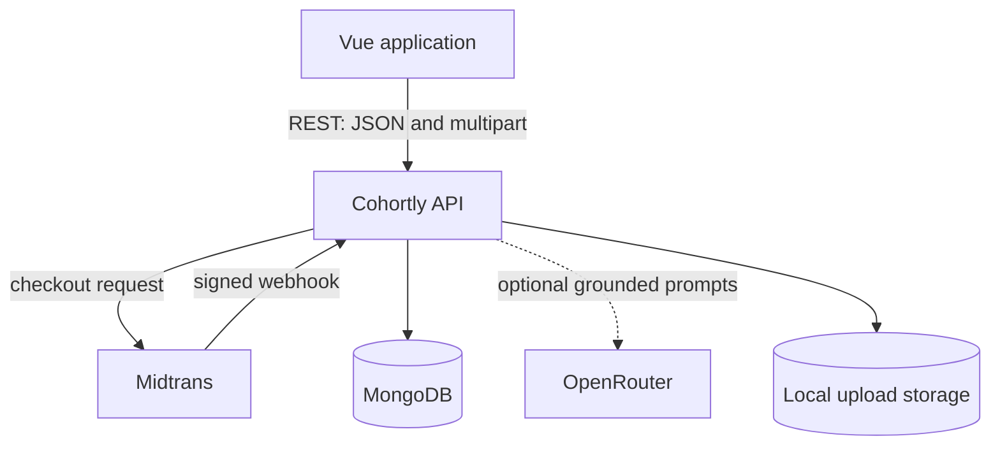
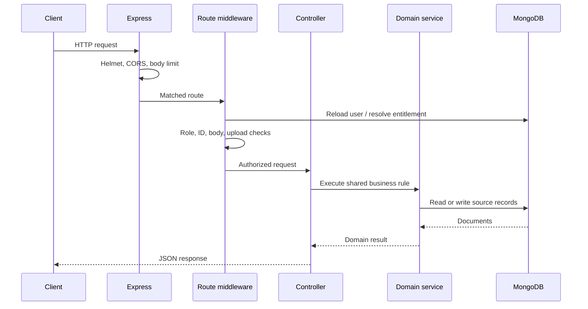
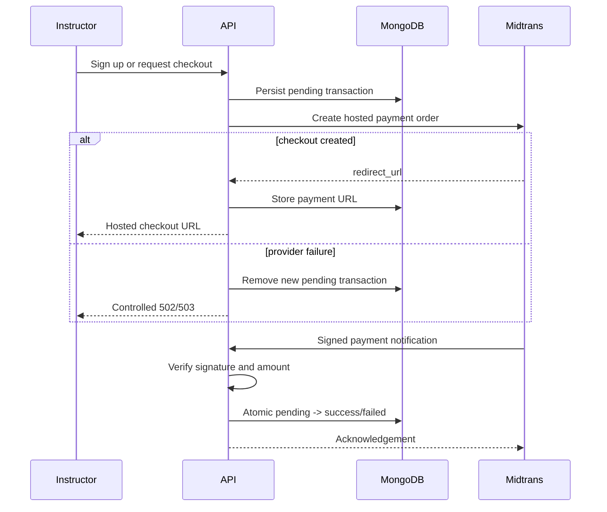
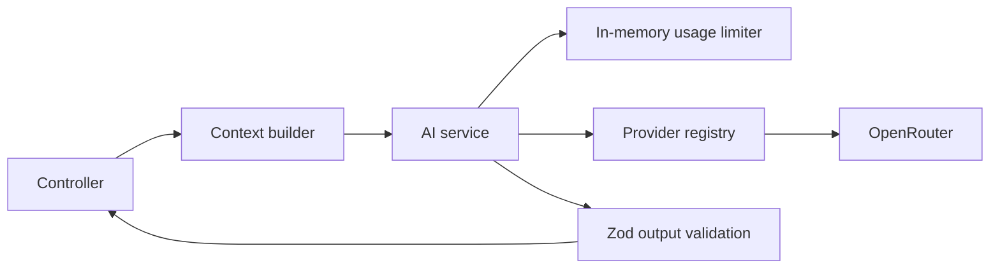

# Architecture

## System context

Cohortly is a single Node.js service that exposes REST endpoints to a separate Vue client. Express owns the HTTP boundary, MongoDB stores application state, Midtrans creates hosted payment sessions and sends payment notifications, and OpenRouter is an optional AI provider.

There is no background worker, message broker, cache service, or scheduled job. Expiration and derived state are evaluated when requests are handled.

## Application components

| Component | Responsibility |
| --- | --- |
| `src/index.js` | Validate configuration, prepare upload directories, connect to MongoDB, and listen |
| `src/app.js` | Build the Express app, global middleware, route mounts, and error handlers |
| `src/routes/` | Map HTTP methods and paths to access, validation, upload, and controller chains |
| `src/middlewares/` | JWT verification, roles, entitlement, rate limits, request validation, and error normalization |
| `src/controllers/` | Translate HTTP input into domain operations and response DTOs |
| `src/services/` | Shared workflows: entitlement, checkout, publishing, learning state, cascades, and certificates |
| `src/services/ai/` | Provider-neutral AI operations, prompts, context construction, limits, and adapters |
| `src/models/` | Mongoose schemas, relationships, indexes, and persistence validation |
| `src/utils/` | Pure rules for subscription periods, progress, quiz scoring, ownership, files, and sanitization |

Controllers may query models directly for simple feature-specific reads and writes. Cross-controller rules live in services or pure utilities; there is no separate repository layer.

## Request pipeline

Not every route invokes every stage. Public health and certificate verification skip JWT checks; Midtrans notifications use a provider signature instead of user authentication.

## Identity, authorization, and entitlement

These concerns are intentionally separate:

1. `verifyToken` accepts only `Authorization: JWT <token>`, verifies HS256, requires issue/expiry timestamps, reloads the user, and checks the token's password credential stamp.
2. `requireRole` enforces the persisted `manager` (instructor) or `student` role. The role is never trusted from the JWT payload.
3. Ownership helpers resolve courses, sections, lessons, quizzes, and students through stored relationships. Existing foreign resources are returned as `404`.
4. `requireActiveAccess` asks the entitlement service for the current workspace state. Instructors use their payment history; students inherit their instructor's state and fail closed if that relationship is invalid.

Identity and payment recovery endpoints remain reachable while access is inactive. Learning and management endpoints require `ACTIVE` entitlement.

## Payment and entitlement flow

Workspace access is not copied to the user. `resolveAccess` replays successful payments in paid order: payment during an active run extends its expiry; payment after expiry begins a new run. This makes expiration a time comparison rather than a scheduled mutation.

## Learning and assessment flow

The authoritative learning state is assembled by `services/learning.js`:

- Course structure is loaded in batches and ordered by explicit section/lesson positions with `_id` tie-breakers.
- Completion records are grouped by course and student.
- Quiz attempts are reduced to attempt count, latest result, best score, and whether any attempt passed.
- Progress is the count of current course lessons with completion records.
- A course without a quiz completes when all lessons are complete. A course with a quiz also requires a passing attempt.
- The next activity is the first incomplete lesson, then the final quiz, then nothing.

Quiz scoring is server-owned. A submission must answer every stored question exactly once with an option belonging to that question. The service ignores client-supplied scoring fields, calculates an integer percentage with equal question weight, and records the passing score used at submission time.

Certificate issuance consumes the same derived course state rather than reimplementing completion. A unique `{ student, course }` index makes issuance idempotent under repeated or concurrent completion requests.

## Publishing and content invariants

A draft course may be freely edited. Publishing requires at least one lesson and, when a quiz exists, a structurally ready quiz. A published course must retain at least one lesson; removing the last lesson requires unpublishing first.

Sections, lessons, and quiz questions use explicit integer order fields. Reorder requests must contain exactly the current child IDs once each. Bulk writes normalize positions to `0..n-1`.

Lesson rich text is sanitized at write time. Legacy content is also sanitized when presented. Student quiz DTOs are explicit allow-lists that exclude correct-answer identifiers.

## AI boundary

AI is an optional adapter layer rather than a dependency of LMS rules.

The backend constructs prompts from content the caller is already authorized to read. Lesson tools receive course/section/lesson titles, lesson text, and the student's question; quiz drafts receive owned course text. Tokens, email addresses, payment data, certificates, internal IDs, other users, and answer keys are excluded.

User content is placed in data boundaries, boundary-like tags are removed, context size is capped, and provider output is treated as untrusted. Invalid structured output is retried once and then mapped to a controlled error. Only summaries are cached; questions, practice sets, and quiz drafts are transient.

OpenRouter is implemented. The Gemini module is an explicit disabled extension point that returns `AI_NOT_CONFIGURED`.

## Consistency model

The service supports a standalone MongoDB deployment and therefore does not assume multi-document transactions.

- Payment provider calls use compensation: the pending transaction is written before the external request and removed if that request fails.
- Webhooks use one conditional update to make terminal transitions idempotent.
- Completion and certificate uniqueness are enforced with database indexes, closing concurrent-request races.
- Cascades delete dependent learning records before the parent, limiting orphan creation if a process stops mid-operation.
- Reorders remain deterministically sortable even if an ordered bulk write is interrupted; repeating the request repairs positions.

This is a deliberate consistency model, not equivalent to transactionally atomic multi-document changes.

## Error boundary

`errorHandler` maps known domain, validation, Mongoose, Multer, parsing, duplicate-key, and optimistic-concurrency failures into safe JSON. Unexpected errors are logged server-side and returned as a generic `500`. Provider adapters convert upstream failures into application-owned messages and codes rather than returning raw provider bodies.

## Deployment considerations

The repository does not include a deployment manifest or CI workflow. Before a multi-instance deployment:

- replace in-memory HTTP and AI limits with a shared store;
- move uploads from local disk to shared/object storage;
- configure `TRUST_PROXY` to match the reverse-proxy topology;
- set an explicit CORS allow-list and strong JWT secret;
- decide whether replica-set transactions are needed for multi-document workflows;
- add centralized logs, metrics, health monitoring, and secret management;
- generate an OpenAPI contract if third-party API consumers are expected.
