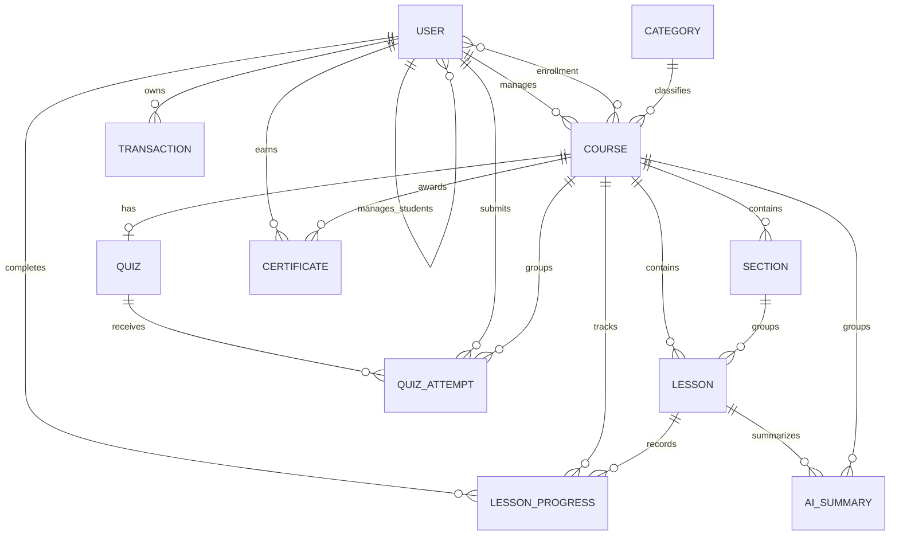

# Database design

## Persistence model

Cohortly stores application data in MongoDB through Mongoose. Collections use references for independently queried domain objects and embedded documents for quiz questions/options, which are always loaded and updated as part of their quiz.

## Collections

### `users`

Stores instructors and students in one collection.

- `role` is persisted as `manager` for instructors and `student` for learners.
- A student references its owning instructor through `manager`.
- `courses` contains course references relevant to the account.
- Email is normalized to lowercase and protected by a unique index.
- Passwords contain bcrypt hashes; `passwordChangedAt` is the credential version used to invalidate older JWTs.

### `categories`

Stores category names and reverse course references. Categories are initialized explicitly with `npm run seed`; the server does not seed at startup.

### `courses`

Stores metadata, owner, category, enrolled students, thumbnail filename, and `draft|published` status. Course content is not embedded: sections and lessons have their own collections.

Indexes support instructor course lists and student/published course lookups.

### `sections` and `lessons`

Sections reference one course and carry an explicit order. Lessons reference both their course and section, which allows authorization and progress queries without first joining through a section.

Lessons are either:

- `text`, storing sanitized rich HTML; or
- `video`, storing a YouTube video ID.

The `legacyDetailId` field exists only for migrated legacy content and has a partial unique index, making the migration idempotent.

### `lessonprogresses`

One record means that one student completed one lesson. The collection does not store a percentage or course-complete flag.

The unique `{ student, lesson }` index makes completion idempotent. Additional indexes support student/course aggregation and instructor reporting.

### `quizzes`

Each course has at most one final quiz, enforced by a unique `course` index. Questions and options are embedded with stable ObjectIds and explicit order fields.

`correctOption` references exactly one embedded option. Student presenters never expose it; instructor management presenters translate it into editable `isCorrect` flags.

### `quizattempts`

Each submission creates a new immutable attempt. It stores the submitted option IDs, server-calculated correctness, score, pass/fail result, and the passing threshold in effect at submission time.

Attempts are indexed for per-student history, instructor reporting, and course cascades. A passed state is derived by checking whether any historical attempt passed.

### `certificates`

Certificates are issued historical snapshots. They copy the student, course, and instructor names plus lesson count, final score, certificate number, and issue date.

Two unique indexes enforce:

- one certificate number globally; and
- one certificate per student/course pair.

Snapshots intentionally remain verifiable after a related course or account changes or is deleted.

### `transactions`

Transactions are payment records with `pending|success|failed` status, activation/renewal purpose, price, period length, payment URL, provider status, and confirmation time.

They do not store the current entitlement. Access is derived by replaying successful payment grants in `paidAt` order.

### `aisummaries`

Stores only derived lesson summaries. The unique cache key is lesson + content hash + provider + model, so edited content does not reuse a stale summary. Student questions, provider answers, practice questions, and quiz drafts are not persisted.

## Integrity rules

| Rule | Enforcement |
| --- | --- |
| Unique account email | Mongoose unique index plus application conflict check |
| One completion per student/lesson | Unique compound index and upsert |
| One final quiz per course | Unique course index plus conflict handling |
| One certificate per student/course | Unique compound index with race recovery |
| Unique certificate number | Unique index with bounded regeneration attempts |
| Ordered content | Explicit order fields; complete-list validation before bulk reorder |
| Published course has content | Publish eligibility and last-lesson deletion guard |
| Payment applied once | Atomic update conditioned on `status: pending` |
| Enrollment ownership | Course and student must share the authenticated instructor |

## Derived state

The following values are deliberately not persisted:

- workspace access state and expiration status;
- lesson progress percentage;
- current course completion;
- next lesson/next activity;
- quiz summary state (`locked`, `not-ready`, `available`, `passed`);
- instructor dashboard aggregates.

They are calculated from payment, structure, completion, attempt, enrollment, and certificate source records. This prevents duplicated counters from becoming stale when content or enrollment changes.

## Deletion policy

Application cascades are explicit in `src/services/cascade.js`.

| Operation | Removed | Retained |
| --- | --- | --- |
| Delete lesson | Lesson completions and cached summaries for the lesson | Quiz attempts and certificates |
| Delete section | Child lessons, their completions, and summaries | Quiz attempts and certificates |
| Delete course | Progress, summaries, attempts, quiz, lessons, sections, and enrollment references | Issued certificates |
| Delete student | Progress, attempts, course enrollment references, and user | Issued certificates |
| Unenroll student | Progress and attempts for that course; both enrollment references | User and issued certificates |
| Delete quiz | Quiz document | Existing attempts and certificates |

Certificates are retained because they record an event that already occurred. A complete erasure request would require an explicit administrative process; no certificate-deletion endpoint exists.

## Seeds, migrations, and backfills

These commands never run automatically at application startup.

| Command | Purpose |
| --- | --- |
| `npm run seed` | Idempotently ensure reference categories |
| `npm run seed:demo` | Reset and populate the guarded Cohortly demo workspace |
| `npm run migrate:content -- --dry-run` | Report legacy flat-content migration changes |
| `npm run migrate:content` | Copy legacy course details into sections/lessons without deleting legacy rows |
| `npm run backfill:paid-at -- --dry-run` | Report legacy successful payments missing `paidAt` |
| `npm run backfill:paid-at` | Persist legacy payment time and one-month period |
| `npm run backfill:certificates -- --dry-run` | Report currently eligible historical completions |
| `npm run backfill:certificates` | Issue missing certificates through the normal eligibility service |
| `npm run check:emails` | Read-only report of duplicate or mixed-case emails |

Run every write migration against a backup and review its dry-run output first. The content migration and backfills are idempotent, but their documented reconstruction rules cannot recover historical facts that were never stored.

## Transaction boundary

The implementation targets standalone MongoDB and does not use multi-document transactions. Cascades remove children before parents, and reorder operations use ordered bulk writes with deterministic tie-breaking. This reduces inconsistent outcomes and supports repair by repeating an operation, but does not provide all-or-nothing atomicity across collections.
